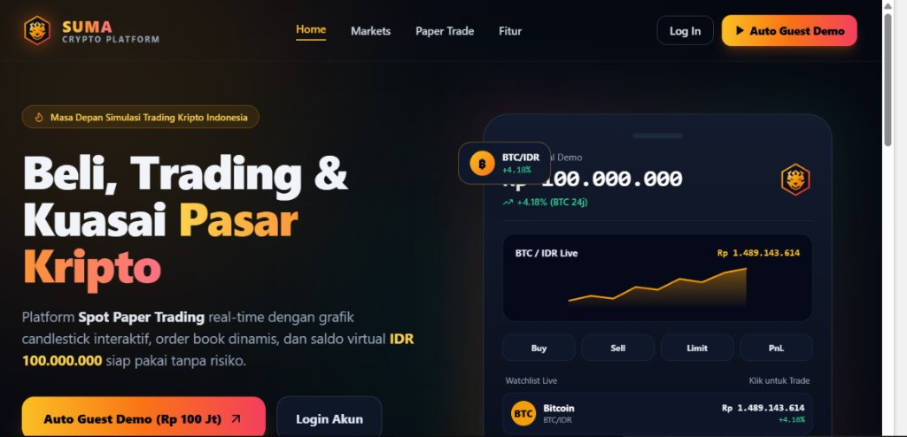
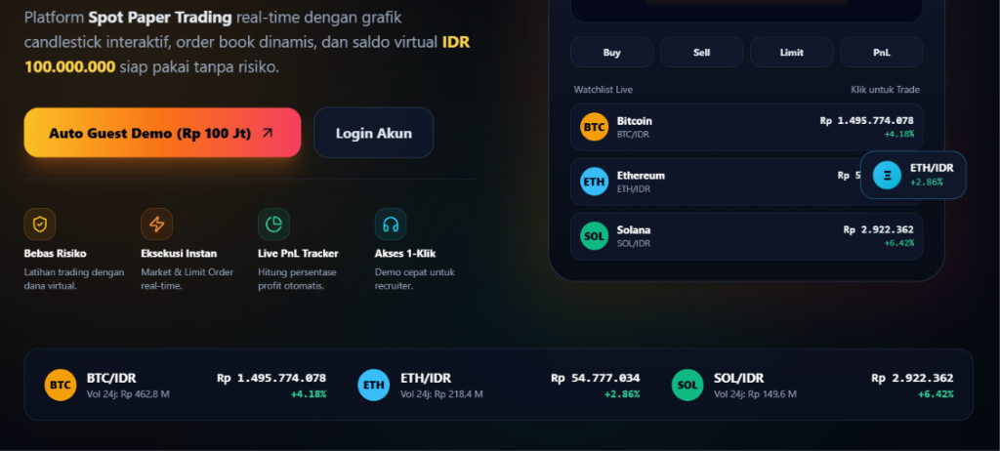
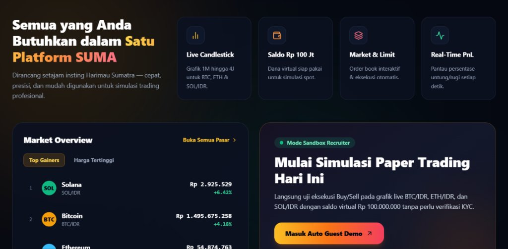
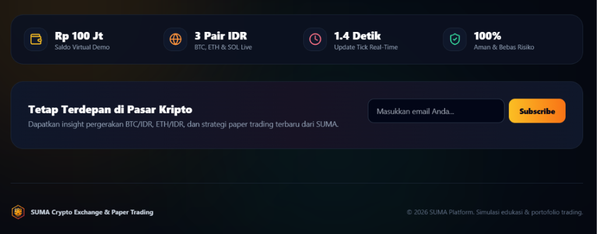

# SUMA — Crypto Exchange & Paper Trading Platform 🐅

<p align="center">
  
</p>

<p align="center">
  <strong>Platform Spot Paper Trading Kripto Indonesia Real-Time</strong><br />
  Grafik Candlestick Interaktif • Order Book Dinamis • Modal Virtual Rp 100.000.000 • Live PnL Tracker
</p>

<p align="center">
  
  
  
  
  
  
  
</p>

---

## 📖 Tentang SUMA

> *"Dirancang setajam insting Harimau Sumatra — cepat, presisi, dan mudah digunakan untuk simulasi trading profesional."*

**SUMA** adalah aplikasi web fullstack simulasi jual-beli aset kripto (*spot paper trading*) real-time yang dirancang khusus untuk trader Indonesia. Menggunakan kuotasi pasangan mata uang Rupiah (**BTC/IDR**, **ETH/IDR**, dan **SOL/IDR**), platform ini menyajikan pengalaman trading profesional seperti Binance dan Indodax tanpa risiko finansial nyata.

### 🎯 User Story (Recruiter Experience)
> **Recruiter membuka link aplikasi** ➔ Melihat landing page resmi SUMA ➔ Mengklik tombol **Auto Guest Demo (Rp 100 Jt)** tanpa perlu registrasi ➔ Langsung masuk ke trading workstation dengan grafik live yang bergerak ➔ Melakukan simulasi order **Buy/Sell (Market & Limit)** dengan saldo virtual **IDR 100.000.000** ➔ Memantau untung/rugi portofolio (*PnL*) secara real-time.

---

## 📸 Tampilan Antarmuka (Screenshots)

### 1. Hero Landing Page & Watchlist Preview
Tampilan beranda modern dengan tema *Dark Cyber Gold/Amber*, lambang Harimau Sumatra bercahaya, dan widget kartu preview harga langsung.


### 2. Keunggulan Fitur & Ticker Strip Real-Time
Highlight 4 pilar utama platform beserta baris ticker harga real-time BTC, ETH, dan SOL beserta volume 24 jam.


### 3. Bento Features & Market Overview
Kartu bento interaktif dan tabel ringkasan pasar dengan filter *Top Gainers* dan *Harga Tertinggi*, bersanding dengan kartu akses cepat *Mode Sandbox Recruiter*.


### 4. Statistik Performa & Newsletter Insight
Bilah statistik performa tick 1.4 detik dan form berlangganan insight pasar kripto terbaru.


---

## ✨ Fitur-Fitur Utama

### 1. ⚡ 1-Click Auto Guest Demo (Khusus Recruiter)
- **Tanpa KYC & Tanpa Registrasi Rumit:** Recruiter dapat langsung mencoba platform dengan saldo virtual **Rp 100.000.000**.
- **Tombol Reset Saldo:** Kembalikan modal awal ke Rp 100 Juta kapan saja dalam 1-klik untuk mengulang skenario simulasi.

### 2. 📈 Grafik Candlestick Real-Time (TradingView Engine)
- Didukung oleh pustaka resmi **TradingView Lightweight Charts v4**.
- Pilihan timeframe lengkap: **1M, 5M, 15M, 1J, 4J, 1H**.
- Mode tampilan ganda: **Candlestick** atau **Line Area Chart**.
- Tooltip dinamis: Menampilkan data **OHLC** (Open, High, Low, Close) dan persentase perubahan harga bar.
- Animasi tick flash hijau/merah pada harga terkini setiap 1.4 detik.

### 3. 📊 Order Book Interaktif & Live Trade Feed
- **Bilah Kedalaman Pasar (*Depth Bar*):** Visualisasi Asks (Merah) dan Bids (Hijau) proporsional secara real-time.
- **Spread Real-Time:** Menghitung selisih harga terbaik jual dan beli dalam Rupiah dan persentase spread.
- **Klik Cepat:** Mengklik harga manapun di Order Book otomatis mengisi harga di form order.
- **Aliran Transaksi Terkini:** Feed eksekusi transaksi pasar yang terus mengalir real-time.

### 4. 💼 Spot Paper Trading Engine (Market & Limit Orders)
- **Market Buy / Sell:** Eksekusi instan pada harga pasar terkini.
  - Memotong/menambah saldo IDR secara akurat.
  - Menghitung *weighted average buy price* (harga beli rata-rata) otomatis.
- **Limit Buy / Sell:** Memasang target harga beli di bawah harga pasar atau jual di atas harga pasar.
  - **Auto-Execution Watcher:** Order otomatis tereksekusi (*auto-filled*) begitu harga live pasar menyentuh target limit!
  - Tab **Order Terbuka:** Pengguna dapat membatalkan limit order kapan saja dan dana yang ditahan otomatis dikembalikan.
- **Tombol Alokasi Cepat:** Tombol praktis **25%**, **50%**, **75%**, dan **100%** dari saldo yang tersedia.

### 5. 🧮 Portofolio & Real-Time PnL Tracker
- Menghitung **Total Nilai Estimasi Portofolio** (Kas IDR + Nilai Pasar Aset Kripto).
- Menghitung **Untung / Rugi Bersih (PnL)** dalam Rupiah dan persentase return secara live.
- Tabel kepemilikan aset: Jumlah koin, harga beli rata-rata (*cost basis*), nilai pasar sekarang, dan PnL tiap koin.
- Progress bar visual alokasi saldo tunai (*cash*) vs kripto.

### 6. 🌐 Integrasi CoinGecko API + Caching
- Mengambil data harga live dari **CoinGecko API** untuk mata uang IDR.
- Server-side in-memory cache (30 detik) pada route `/api/crypto/markets` dan `/api/crypto/ohlc` untuk mencegah limit kuota API.
- Generator mikro-tick real-time untuk memastikan exchange selalu aktif bergerak mulus.

### 7. 🛡️ Database Supabase Ready (PostgreSQL)
- Skema PostgreSQL lengkap tersedia di [`supabase_schema.sql`](supabase_schema.sql).
- Menangani tabel `profiles`, `portfolios`, `holdings`, dan `orders` lengkap dengan kebijakan *Row Level Security (RLS)*.
- **Sistem Hybrid:** Berjalan 100% mulus sebagai guest session lokal tanpa konfigurasi awal, dan otomatis tersinkronisasi ke PostgreSQL Supabase saat login.
- Dilengkapi layar khusus panduan konfirmasi email (*email verification flow*) saat pendaftaran akun baru.

---

## 🛠️ Tech Stack

| Komponen | Teknologi |
| :--- | :--- |
| **Framework** | [Next.js 14](https://nextjs.org/) (App Router) |
| **Bahasa** | [TypeScript](https://www.typescriptlang.org/) |
| **Styling** | [Tailwind CSS](https://tailwindcss.com/) (Dark Mode Cyber Gold/Amber) |
| **Grafik Keuangan** | [TradingView Lightweight Charts v4](https://tradingview.github.io/lightweight-charts/) |
| **Komponen UI & Ikon** | [Lucide React](https://lucide.dev/), Radix UI Primitives |
| **Notifikasi Toast** | [Sonner](https://sonner.emilkowal.ski/) |
| **Market Data** | [CoinGecko API v3](https://www.coingecko.com/en/api) |
| **Database & Auth** | [Supabase](https://supabase.com/) (PostgreSQL & Row Level Security) |
| **State & Storage** | React Context API, LocalStorage Persistence |

---

## 📂 Struktur Direktori

```
suma-crypto-exchange/
├── docs/
│   └── screenshots/              # Gambar preview untuk dokumentasi GitHub
│       ├── hero-preview.jpg
│       ├── features-preview.png
│       ├── market-preview.jpg
│       └── stats-preview.png
├── public/                       # Favicon & aset publik statis
│   ├── icon.svg
│   ├── favicon.svg
│   └── screenshots/
├── src/
│   ├── app/
│   │   ├── api/crypto/
│   │   │   ├── markets/route.ts  # Endpoint data pasar live IDR CoinGecko
│   │   │   └── ohlc/route.ts     # Endpoint data candlestick OHLC
│   │   ├── markets/page.tsx      # Halaman direktori pasar kripto IDR
│   │   ├── trade/page.tsx        # Halaman utama trading workstation
│   │   ├── layout.tsx            # Global root layout, provider & metadata
│   │   ├── page.tsx              # Landing page resmi SUMA
│   │   └── globals.css           # Styling global & scrollbar kustom
│   ├── components/
│   │   ├── common/
│   │   │   ├── Navbar.tsx        # Navigasi utama dengan saldo demo & profil
│   │   │   ├── Footer.tsx        # Footer resmi SUMA 2026
│   │   │   ├── TigerLogo.tsx     # Logo lambang Harimau Sumatra
│   │   │   └── AuthModal.tsx     # Modal login, daftar & info verifikasi email
│   │   ├── landing/              # Komponen Landing Page (Hero, Bento, Ticker, Stats)
│   │   └── trading/              # Komponen Trading (TV Chart, Order Book, Form, PnL)
│   ├── context/
│   │   ├── MarketDataContext.tsx # State live price, order book & recent trades
│   │   └── TradingContext.tsx    # Mesin eksekusi paper trading & sinkronisasi Supabase
│   ├── lib/
│   │   ├── coingecko.ts          # Layanan API CoinGecko dengan cache
│   │   ├── supabase.ts           # Konfigurasi klien Supabase
│   │   ├── constants.ts          # Pasangan BTC, ETH, SOL & saldo awal 100 Jt
│   │   └── utils.ts              # Formatter Rupiah deterministik 100%
│   └── types/                    # TypeScript interfaces & types
├── supabase_schema.sql           # Skrip SQL tabel database Supabase
├── .env.example                  # Template variabel lingkungan
├── package.json
└── README.md
```

---

## 🚀 Panduan Instalasi & Menjalankan Lokal

Ikuti langkah-langkah berikut untuk menjalankan project ini di komputer lokal Anda:

### 1. Clone Repositori
```bash
git clone https://github.com/<username-anda>/suma-crypto-exchange.git
cd suma-crypto-exchange
```

### 2. Install Dependensi
Gunakan **pnpm** (direkomendasikan) atau **npm**:
```bash
pnpm install
# atau
npm install
```

### 3. Konfigurasi Environment Variables (`.env.local`)
Salin file `.env.example` menjadi `.env.local`:
```bash
cp .env.example .env.local
```

Buka `.env.local` dan sesuaikan nilainya:
```env
# CoinGecko Demo API Key
NEXT_PUBLIC_COINGECKO_API_KEY=CG-PVwDaDSrWMyCk7Y9Fn4uh5Mm
COINGECKO_API_KEY=CG-PVwDaDSrWMyCk7Y9Fn4uh5Mm

# Supabase Configuration
NEXT_PUBLIC_SUPABASE_URL=https://your-project.supabase.co
NEXT_PUBLIC_SUPABASE_ANON_KEY=your-supabase-publishable-key
```

### 4. (Opsional) Setup Database Supabase
Jika ingin fitur login dan sinkronisasi database aktif:
1. Buka dashboard [Supabase](https://supabase.com/).
2. Buka menu **SQL Editor**, buat query baru, dan salin seluruh isi file [`supabase_schema.sql`](supabase_schema.sql).
3. Klik **Run** untuk membuat tabel `profiles`, `portfolios`, `holdings`, `orders`, dan trigger otomatisnya.
4. *(Disarankan)* Di menu **Authentication** -> **Providers** -> **Email**, matikan toggle **Confirm email** jika ingin akun langsung aktif tanpa verifikasi email.

### 5. Jalankan Development Server
```bash
pnpm dev
# atau
npm run dev
```

Buka browser di:
- **Landing Page:** [http://localhost:3000](http://localhost:3000)
- **Trading Workstation:** [http://localhost:3000/trade](http://localhost:3000/trade)
- **Pasar Kripto:** [http://localhost:3000/markets](http://localhost:3000/markets)

### 6. Build untuk Produksi
```bash
pnpm build
pnpm start
```

---

## 📤 Panduan Upload ke GitHub

Jalankan perintah berikut di terminal folder project untuk mengunggah kode ke akun GitHub Anda:

```bash
# 1. Inisialisasi Git (jika belum)
git init

# 2. Tambahkan semua file ke staging area
git add .

# 3. Buat commit pertama
git commit -m "feat: complete SUMA Crypto Exchange and Paper Trading platform"

# 4. Ganti nama branch utama menjadi main
git branch -M main

# 5. Hubungkan ke repositori GitHub Anda (ganti URL dengan URL repo Anda)
git remote add origin https://github.com/<username-anda>/suma-crypto-exchange.git

# 6. Push kode ke GitHub
git push -u origin main
```

---

## 👨‍💻 Kontributor & Lisensi

Dibuat dengan dedikasi tinggi sebagai showcase portofolio engineering **Fullstack Web Developer**.

- **Platform:** SUMA Crypto Exchange
- **Tahun:** 2026
- **Lisensi:** [MIT License](LICENSE)

---

<p align="center">
  Dibuat dengan ❤️ dan semangat Harimau Sumatra 🐅
</p>
